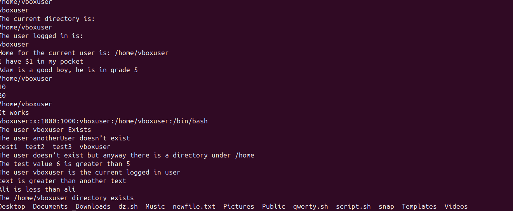
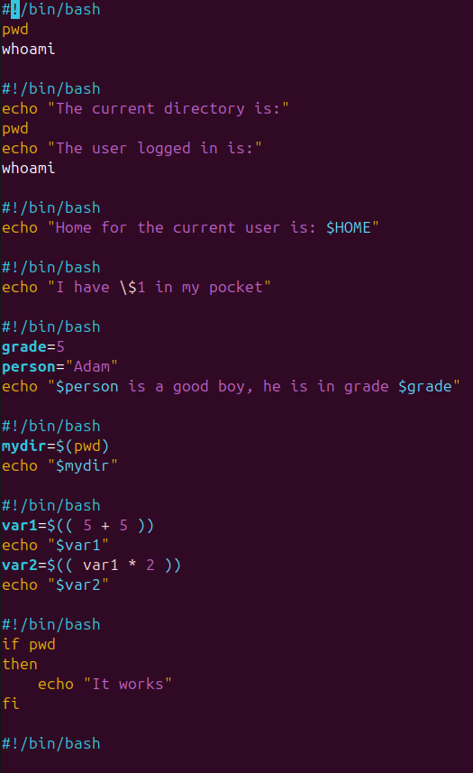
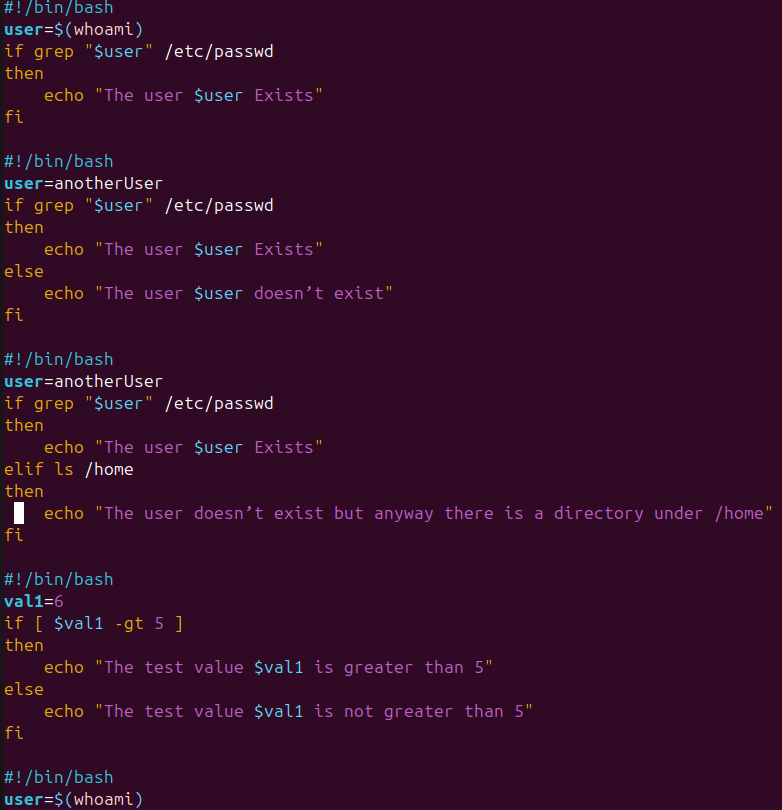
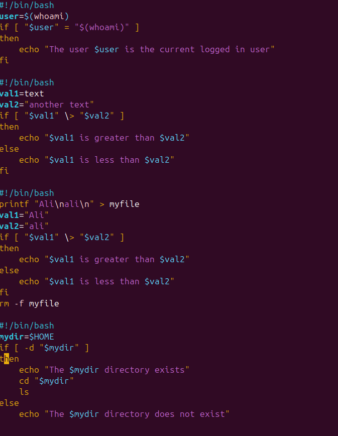

# Домашняя работа 12.10. Базовые конструкции Bash

## Что сделано

Собраны короткие сценарии Bash до циклов: переменные, арифметика и ветвление `if`/`else`/`elif`.

- Скрипт печатает каталог, пользователя и `$HOME`, подставляет переменные `person` и `grade`.
- `$(( ... ))` считает сумму и произведение.
- `if` проверяет команду, наличие пользователя в `/etc/passwd`, число через `-gt`, строки и каталог через `-d`.
- `else` и `elif` задают запасную ветку, если проверка не прошла.

## Ход работы

Вывод сценариев: каталог, пользователь, арифметика и проверки.

Переменные, арифметика и простой `if`.

Проверка пользователя, `else` и `elif`.

Сравнение строк и проверка, что каталог существует.

