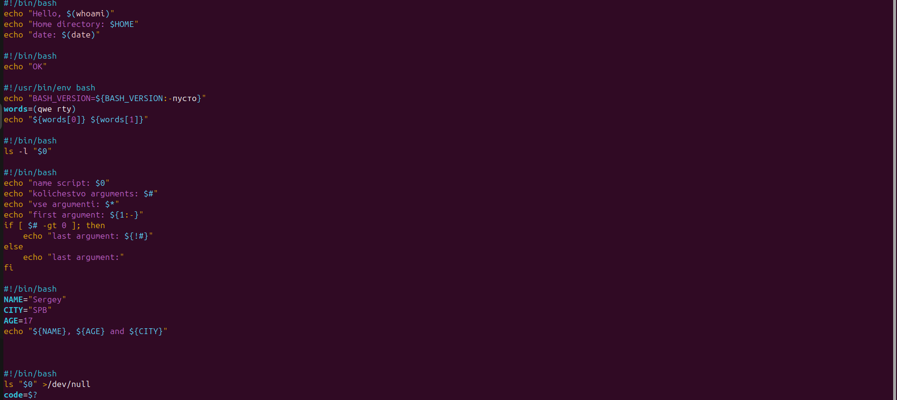
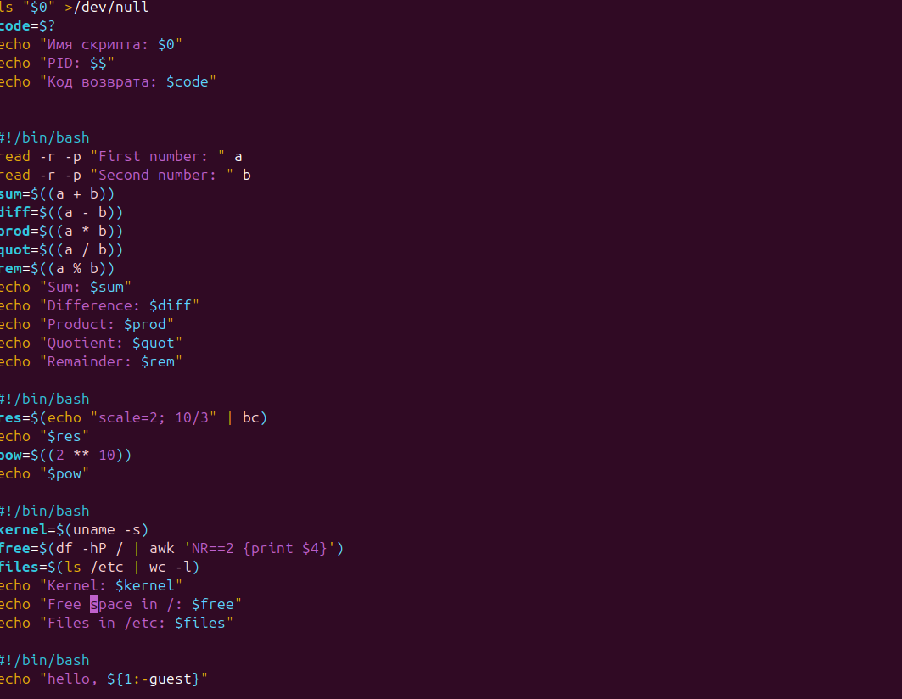
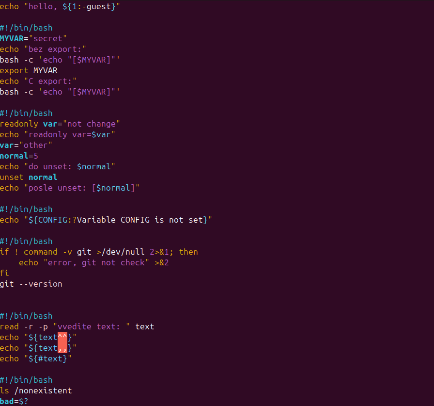
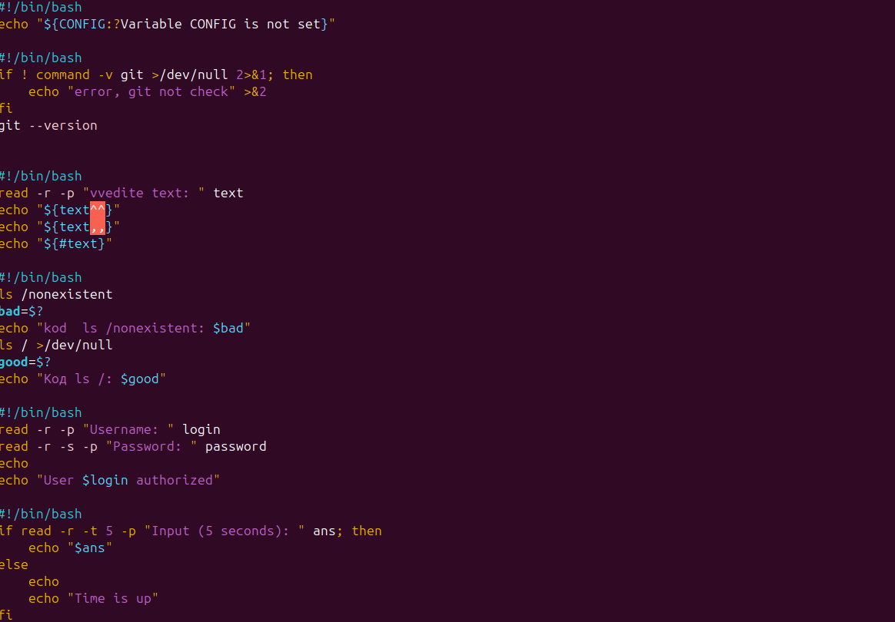

# Домашняя работа 13.10. Основы Bash-скриптинга

## Что сделано

Отработаны приёмы сценариев командной строки: вывод, аргументы, подстановка команд и ввод.

- `echo` подставляет `$(whoami)`, `$HOME`, `$(date)` и элементы массива.
- `$0`, `$#`, `$*` и `$1` показывают имя скрипта и аргументы, `$$` — PID, `$?` — код возврата.
- `read` запрашивает два числа, `$(( ... ))` считает сумму, разность, произведение, частное и остаток. Дробный результат считается через `bc`.
- `export` передаёт переменную в дочерний процесс, `readonly` запрещает изменение, `unset` удаляет переменную.
- `${текст^^}`, `${текст,,}` и `${#текст}` меняют регистр и считают длину. `read -s` скрывает пароль, `read -t` ограничивает время ввода.

## Ход работы

Приветствие, массив, аргументы скрипта и переменные.

Код возврата, арифметика по двум числам и подстановка команд.

`export`, `readonly`, значение по умолчанию и проверка `git`.

Код возврата команды, скрытый ввод пароля и ввод с таймаутом.

