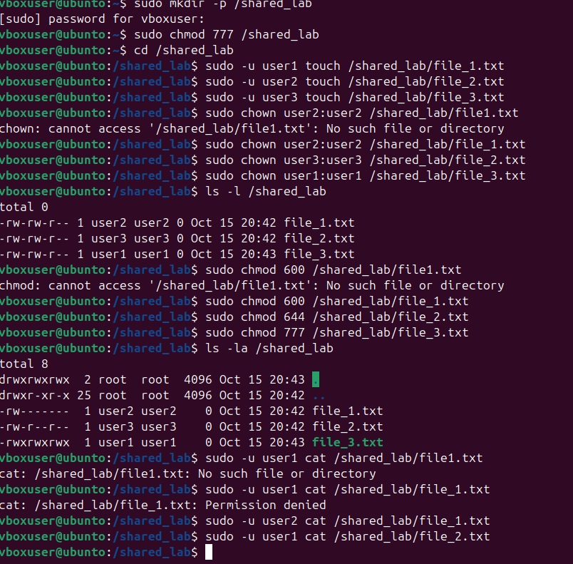

# Домашняя работа 15.09. Владельцы и права доступа

## Что сделано

Отработана смена владельца и прав доступа к файлам в общем каталоге `/shared_lab`.

- Создан каталог `/shared_lab`, права выставлены в `777`.
- От имени `user1`, `user2` и `user3` созданы `file_1.txt`, `file_2.txt` и `file_3.txt`.
- Командой `chown` каждому файлу назначены свой владелец и своя группа.
- Командой `chmod` выставлены права `600`, `644` и `777`.
- Чтение проверено через `sudo -u`: у `user1` нет доступа к `file_1.txt` (`Permission denied`), `user2` читает свой файл.

## Ход работы

