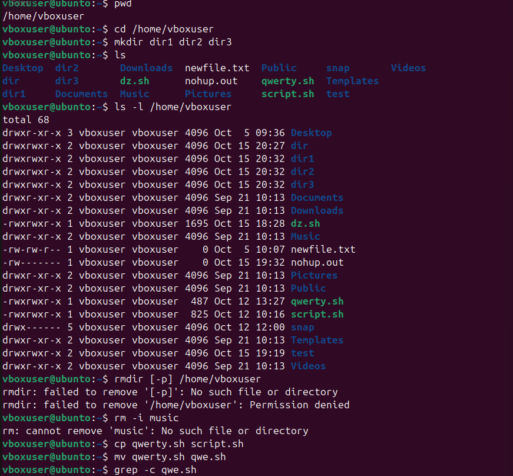

# Домашняя работа 21.09. Операции с файлами и каталогами

## Что сделано

Отработаны базовые команды навигации и работы с файлами в домашнем каталоге.

- `pwd` и `cd` показывают и меняют текущий каталог.
- `mkdir` создаёт каталоги `dir1`, `dir2` и `dir3`, `ls` и `ls -l` выводят их список и права.
- `rmdir` и `rm -i` проверяют удаление: пустой путь и несуществующий файл завершаются ошибкой.
- `cp` копирует `qwerty.sh` в `script.sh`, `mv` переименовывает `qwerty.sh` в `qwe.sh`.
- `grep -c` считает вхождения строки в файле.

## Ход работы

