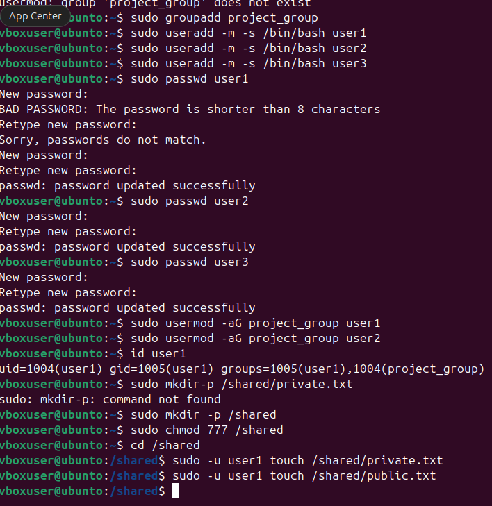
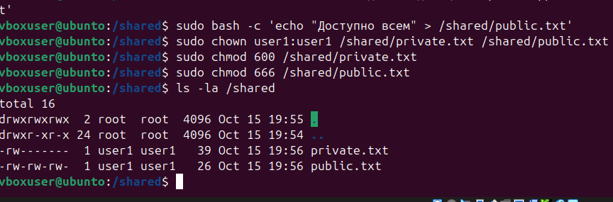
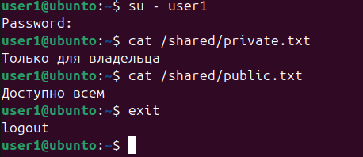
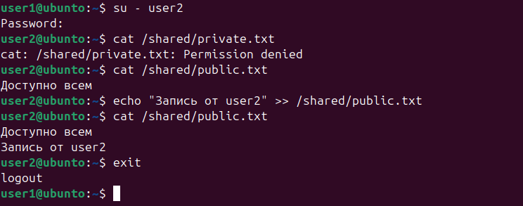

# Домашняя работа 22.09. Пользователи, группы и права доступа

## Что сделано

Созданы пользователи и общая группа, разграничен доступ к файлам в `/shared` и проверен вход под разными учётными записями.

- `groupadd` создаёт группу `project_group`, `useradd` — пользователей `user1`, `user2` и `user3`.
- `passwd` задаёт пароли, `usermod -aG` добавляет пользователей в группу.
- В `/shared` лежат `private.txt` (`chmod 600`, читает только владелец) и `public.txt` (`chmod 666`, доступен всем).
- Под `user1` оба файла читаются. Под `user2` чтение `private.txt` даёт `Permission denied`, а в `public.txt` можно дописать строку.

## Ход работы

Создание пользователей, группы и файлов в `/shared`.

Права: приватный файл `600`, публичный `666`.

Проверка от имени владельца `user1`.

Проверка от имени `user2`: к приватному файлу доступа нет.

