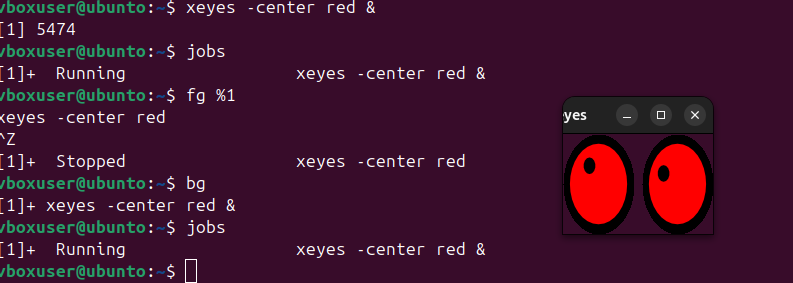
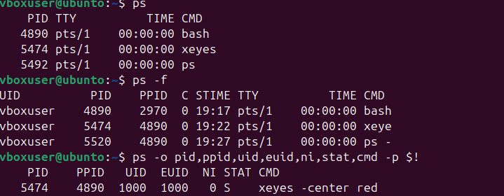
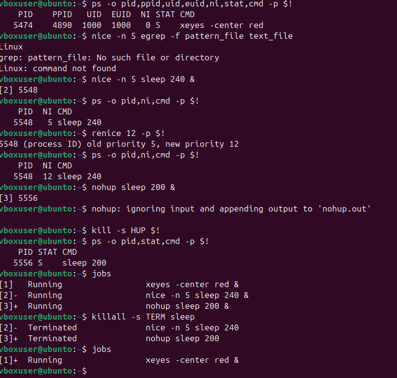
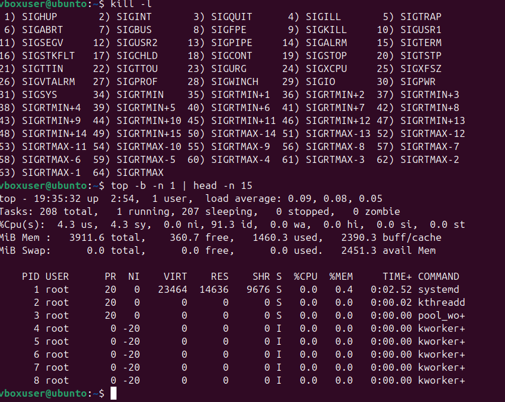

# Домашняя работа 28.09. Процессы и сигналы

## Что сделано

Разобрано управление процессами: фон и передний план, просмотр, приоритет и сигналы.

- `xeyes` запускается в фоне, `jobs`, `fg` и `bg` переключают задачу между передним планом и фоном. `Ctrl+Z` ставит процесс на паузу.
- `ps`, `ps -f` и `ps -o` показывают PID, родителя, пользователя и состояние.
- `nice` запускает `sleep` с пониженным приоритетом, `renice` меняет его у уже запущенного процесса.
- `nohup` оставляет процесс после закрытия терминала. `kill` и `killall` завершают задачи.
- `kill -l` выводит список сигналов, `top` — сводку по процессору и памяти.

## Ход работы

Фоновая задача `xeyes`, `jobs`, `fg` и `bg`.

Дерево процессов и выбранные поля `ps`.

Приоритет `nice`/`renice`, `nohup` и завершение через `kill` и `killall`.

Список сигналов и снимок `top`.

