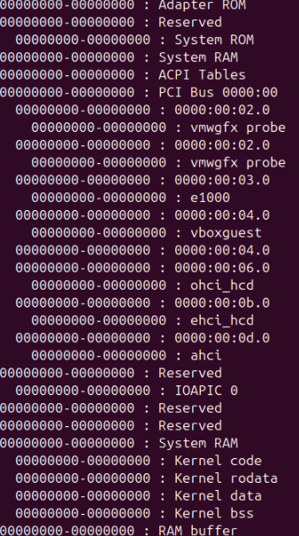
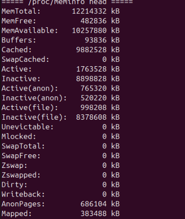
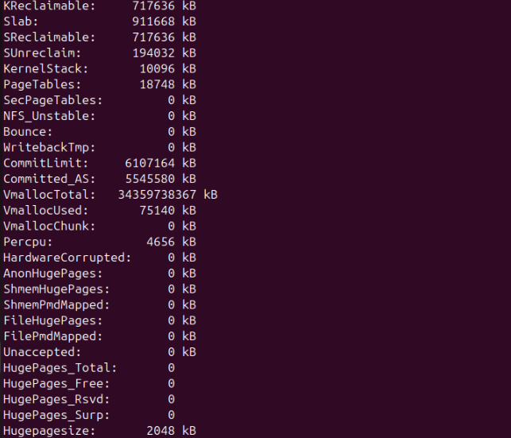
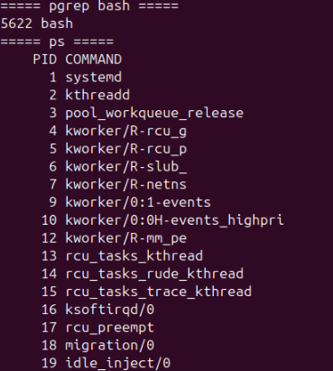
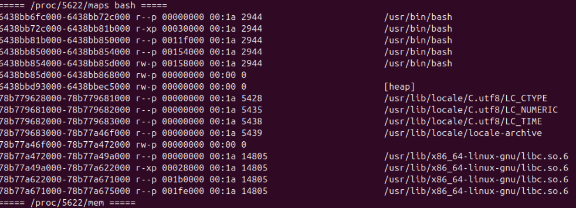
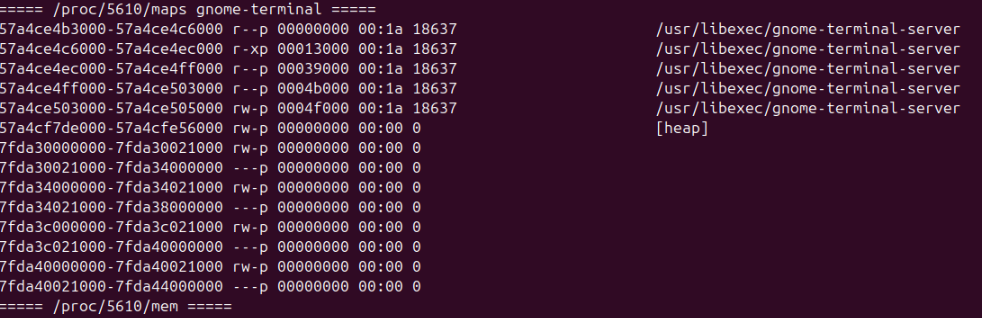

# Домашняя работа 05.10. Память

## Что сделано

Просмотрено, как Linux показывает физическую память и карту адресного пространства процесса.

- `/proc/iomem` — карта физической памяти: System RAM, ядро, ACPI, устройства.
- `/proc/meminfo` — сводка: `MemTotal`, `MemFree`, `MemAvailable`, кэш, swap и huge pages.
- `pgrep bash` находит PID оболочки, `ps` показывает системные потоки.
- `/proc/<pid>/maps` — участки адресного пространства: код, куча `[heap]`, библиотеки. Рядом открывается `/proc/<pid>/mem`.

## Ход работы

Карта физической памяти.

Начало `/proc/meminfo`: общий объём, свободно, доступно, кэш.

Продолжение `/proc/meminfo`: slab, committed memory, huge pages.

Поиск bash и список процессов.

Карта памяти процесса `bash`.

Карта памяти `gnome-terminal`.

