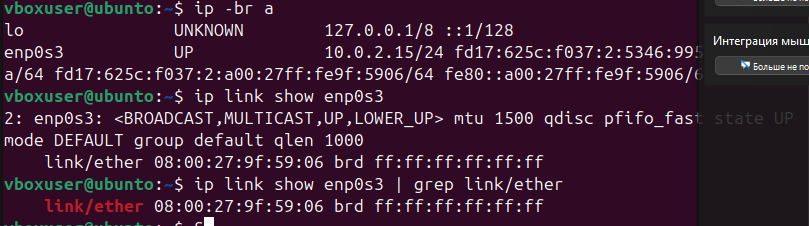
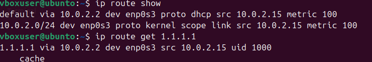
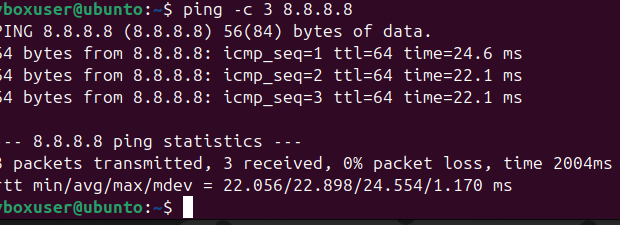
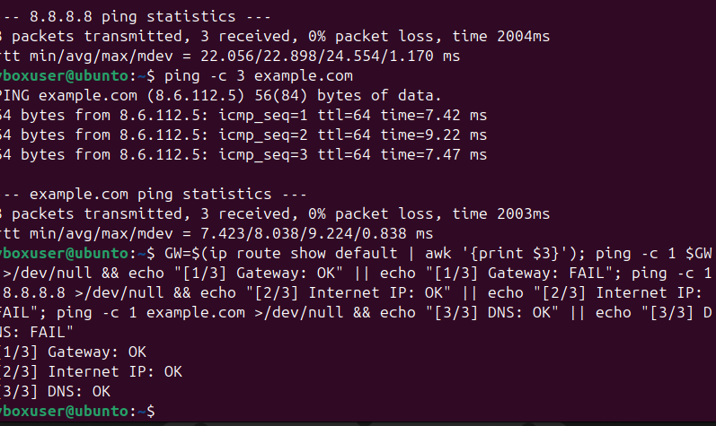
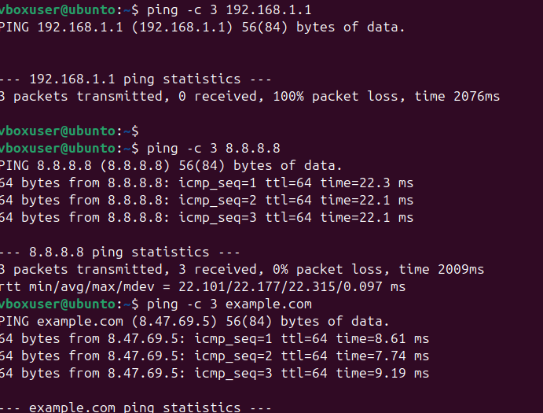
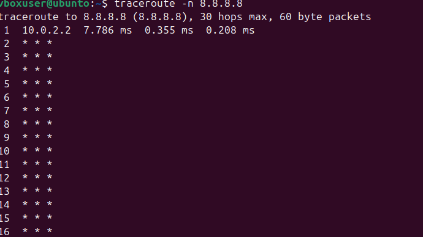
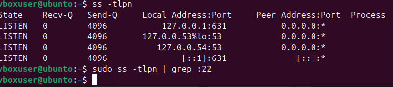
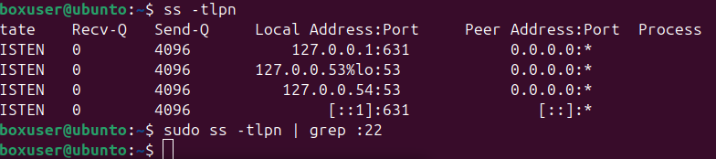
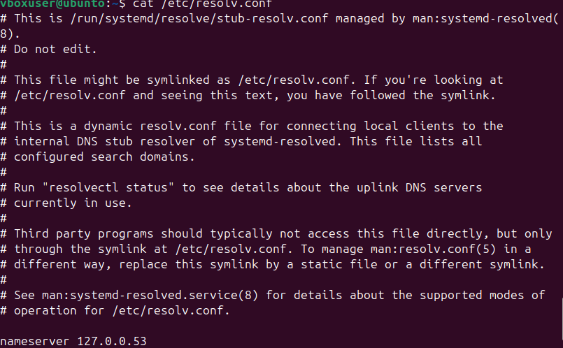
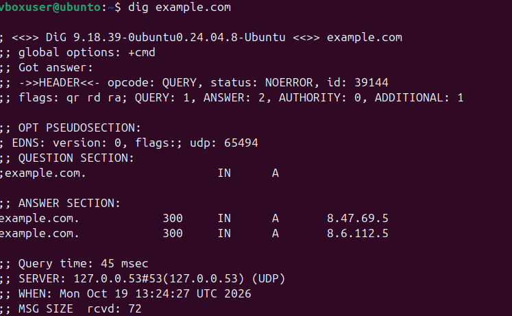

# Практика 19.10. Сеть

## Что сделано

Проверены адрес интерфейса, маршрут, доступность сети, открытые порты и DNS.

- `ip -br a` и `ip link show` показывают адрес и MAC интерфейса `enp0s3`.
- `ip route show` и `ip route get` находят шлюз `10.0.2.2` и маршрут до `1.1.1.1`.
- `ping` проверяет `8.8.8.8`, `example.com` и шлюз. До `192.168.1.1` пакеты не доходят.
- Короткая проверка по шагам печатает `Gateway: OK`, `Internet IP: OK` и `DNS: OK`.
- `traceroute -n` показывает первый переход через шлюз.
- `ss -tlpn` выводит слушающие порты, отдельно проверяется порт `22`.
- `/etc/resolv.conf` указывает на локальный резолвер `127.0.0.53`, `dig example.com` возвращает адреса имени.

## Ход работы

Адрес и состояние интерфейса.

Таблица маршрутов и маршрут до внешнего адреса.

Доступность `8.8.8.8`.

Проверка DNS и трёх шагов: шлюз, внешний IP, имя.

Шлюз локальной сети не отвечает, интернет и DNS отвечают.

Трассировка до `8.8.8.8`.

Слушающие TCP-порты.

Проверка, слушается ли порт 22.

Локальный DNS-резолвер.

Ответ DNS для `example.com`.

