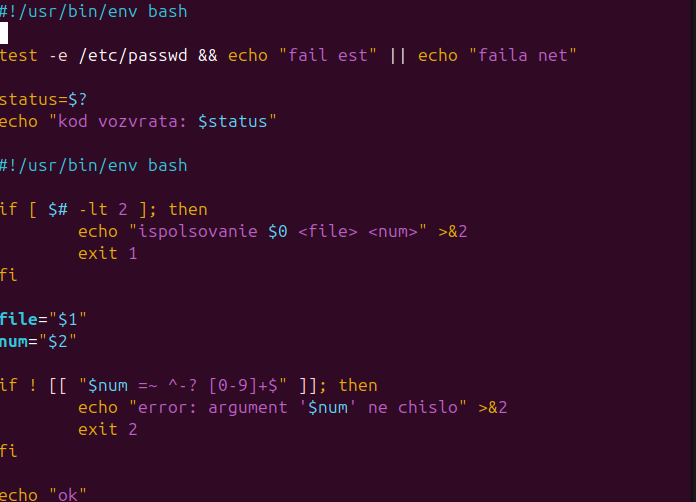
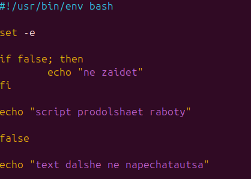

# Практика. Коды возврата и остановка при ошибке

## Что сделано

Разобрано, как скрипт реагирует на успех и ошибку команды.

- `test -e /etc/passwd` связан с `&&` и `||`: при успехе печатается одна строка, при неудаче — другая. `$?` сохраняется в `status`.
- Если аргументов меньше двух или второй аргумент не число, скрипт пишет ошибку в stderr и завершается с кодом `1` или `2`.
- `set -e` останавливает сценарий на первой ошибке: после `false` строка ниже уже не печатается.

## Ход работы

Проверка файла, код возврата и разбор аргументов.

Остановка скрипта на ошибке.

